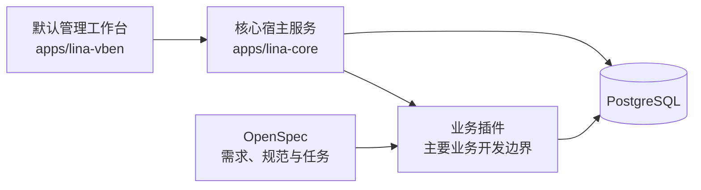
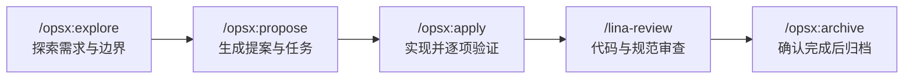

# LinaPro 新开发者项目导览

## 1. 文档目标

本文帮助新开发者完成四件事：

1. 理解`LinaPro`的产品定位和核心架构。
2. 在本地启动宿主后端、默认管理工作台和数据库。
3. 按业务插件边界完成一个功能的端到端开发。
4. 使用项目规定的研发流程和验证门禁交付变更。

开始修改代码前，还必须阅读[顶层项目规范](AGENTS.md)以及变更命中的`.agents/rules/*.md`规则文件。

## 2. 项目定位

`LinaPro`是面向可持续交付的 AI 原生全栈框架，核心能力包括：

- `GoFrame`核心宿主服务和模块化接口能力。
- 基于`Vue 3`、`TypeScript`和`Vben 5`的默认管理工作台。
- 源码插件、动态`WASM`插件和宿主发布服务。
- 用户、角色、菜单、字典、定时任务等内建通用能力。
- 多语言、数据权限、多租户、缓存一致性和集群协调能力。
- 以`OpenSpec`承载的规范驱动研发流程。

默认管理工作台和系统管理模块只是框架提供的默认入口，不代表项目的唯一产品边界。

## 3. 核心架构与开发边界



开发时应遵守以下边界：

| 需求类型 | 默认实施位置 | 关键约束 |
|---|---|---|
| 独立业务功能 | `apps/lina-plugins/<plugin-id>/` | 前后端、SQL、语言资源和测试闭环在插件内 |
| 工作台展示适配 | 工作台适配接口或前端适配层 | 不因展示变化修改核心领域契约 |
| 宿主通用能力 | `apps/lina-core/` | 仅在具备框架开发授权时实施 |
| 构建与治理工具 | `hack/` | 仅在具备工具链开发授权时实施 |

若仓库根目录不存在`.contributing`，严格禁止修改`apps/lina-core/`、`apps/lina-vben/`和`hack/`。本导览所基于的工作区不存在该文件，因此新开发者应默认走业务插件路径。

修改现有插件前，还必须检查该插件根目录是否存在自己的`AGENTS.md`；存在时，插件本地规范在该插件目录内优先生效。

## 4. 仓库目录导览

| 路径 | 主要职责 |
|---|---|
| `apps/lina-core/` | 核心宿主后端、公共服务、系统治理和插件运行时 |
| `apps/lina-vben/` | 默认管理工作台和宿主前端适配层 |
| `apps/lina-plugins/` | 官方业务插件工作区，以子模块管理 |
| `hack/` | 构建、开发、测试、代码生成和仓库治理工具 |
| `openspec/changes/` | 正在进行的规范变更 |
| `openspec/changes/archive/` | 已归档的历史变更 |
| `.agents/rules/` | 各领域开发和审查规则的唯一事实来源 |

## 5. 本地环境准备

### 5.1 环境依赖

| 依赖 | 版本或要求 | 用途 |
|---|---|---|
| `Go` | `1.25+` | 宿主和插件后端 |
| `Node.js` | `22+` | 前端和测试工具 |
| `pnpm` | `10+` | 前端依赖管理 |
| `PostgreSQL` | `14+` | 默认开发数据库 |
| `make` | 可用 | 根目录统一命令入口 |
| `Docker` | 可选 | 快速创建本地数据库 |

单机模式默认不需要`Redis`；只有启用集群协调时才需要准备对应服务。

### 5.2 初始化仓库

在仓库根目录执行：

```bash
git submodule update --init --recursive
make dev.setup
```

第一条命令拉取官方插件工作区。第二条命令安装前端依赖和`Playwright`浏览器。

如果`apps/lina-plugins/`中尚无插件，完成子模块初始化后再参考官方示例：

- 源码插件参考`linapro-demo-source`。
- 动态插件参考`linapro-demo-dynamic`。

### 5.3 准备数据库

默认开发连接为：

```text
pgsql:postgres:postgres@tcp(127.0.0.1:5432)/linapro?sslmode=disable
```

如果使用`Docker`，可以创建与该默认配置匹配的数据库：

```bash
docker run --name linapro-postgres \
  -e POSTGRES_USER=postgres \
  -e POSTGRES_PASSWORD=postgres \
  -e POSTGRES_DB=linapro \
  -p 5432:5432 \
  -d postgres:14-alpine
```

随后初始化宿主表结构和必要种子数据：

```bash
make db.init confirm=init
```

该命令会初始化宿主表结构和种子数据，并删除已有的宿主业务数据；不要对包含重要数据的数据库执行。插件自有表结构通过插件安装流程写入数据库，不应手动复制到宿主 SQL 目录。

### 5.4 启动和验证

```bash
make dev
```

`make dev`会同时启动前后端；检测到已初始化的官方插件清单时，还会准备插件完整开发环境。

| 入口 | 默认值 |
|---|---|
| 管理工作台 | `http://localhost:5666/admin` |
| 后端端口 | `9120` |
| 接口文档 JSON | `http://localhost:9120/api.json` |
| 管理员账号 | `admin` |
| 管理员密码 | `admin123` |

常用服务命令：

```bash
make status
make stop
```

需要覆盖默认端口时，可使用：

```bash
make dev core_port=9121 vben_port=5667
```

## 6. 开发一个业务插件

### 6.1 设计前确认五个决策

| 决策 | 需要确认的内容 |
|---|---|
| 插件类型 | 源码插件或动态`WASM`插件 |
| 多语言 | `plugin.yaml`是否启用`i18n.enabled` |
| 租户边界 | 是否需要多租户数据隔离 |
| 分发方式 | 是否随框架共同编译发布 |
| 删除语义 | 业务表是否需要软删除 |

新手建议先实现单租户源码插件，完整掌握开发闭环后，再引入动态插件、多租户或跨插件能力。

### 6.2 插件目录职责

| 路径 | 内容 |
|---|---|
| `plugin.yaml` | 插件 ID、类型、依赖、能力和多语言声明 |
| `backend/api/` | 请求与响应 DTO、路由和权限标签 |
| `backend/internal/controller/` | HTTP 控制器 |
| `backend/internal/service/` | 业务逻辑和事务编排 |
| `backend/internal/dao/` | 自动生成的数据访问代码 |
| `frontend/pages/` | 插件页面和前端业务组件 |
| `manifest/sql/` | 安装和升级 SQL |
| `manifest/sql/uninstall/` | 卸载 SQL |
| `manifest/i18n/` | 插件自身的运行时和接口文档语言资源 |
| `hack/tests/` | 插件自己的 E2E、页面对象和测试辅助资产 |

插件变更应保持闭环。不要把插件私有逻辑、语言资源或测试资产回流到宿主目录。

### 6.3 数据表和 SQL

数据库设计应与真实查询路径同时完成：

1. 在插件`manifest/sql/`中新增当前迭代的幂等 SQL。
2. 使用`plugin_<plugin_id_snake>_<entity>`命名插件业务表，并保留完整插件 ID。
3. 将必要的初始化数据与演示数据分离；演示数据放入`manifest/sql/mock-data/`。
4. 为筛选、排序、分页、关联和数据权限过滤设计索引。
5. 确认软删除需求后，再决定是否加入`deleted_at`字段。

例如，插件`linapro-demo-source`的记录表可以命名为：

```text
plugin_linapro_demo_source_record
```

SQL 应使用`CREATE TABLE IF NOT EXISTS`、`CREATE INDEX IF NOT EXISTS`或具有真实冲突依据的`INSERT ... ON CONFLICT DO NOTHING`等安全重入方式。禁止在种子数据中显式写入自增主键。

### 6.4 定义 API 契约

先在`backend/api/<resource>/v1/`中定义接口，再生成控制器骨架。

关键约定：

- 查询使用`GET`，创建使用`POST`，更新使用`PUT`，删除使用`DELETE`。
- 路径表达资源，不使用`/getUser`、`/deleteUser`等动作式路径。
- 输入和输出字段完整声明`json`、`dc`和`eg`标签。
- 受保护静态 API 在`g.Meta`中声明`permission`标签。
- 具体时间点响应字段使用 Unix 毫秒时间戳，对应 Go 类型为`int64`或`*int64`。
- 批量 ID 使用数组参数，例如`ids[]=1&ids[]=2`，不使用逗号拼接字符串。
- 列表、导出、树和下拉候选必须具备分页、上限或其他明确的数据边界。

### 6.5 生成后端代码

宿主数据库和插件表结构就绪后，在仓库根目录执行：

```bash
make dao dir=apps/lina-plugins/<plugin-id>/backend
make ctrl dir=apps/lina-plugins/<plugin-id>/backend
```

其中：

- `make dao`生成`DAO`、`DO`和`Entity`代码，依赖可访问且已初始化的数据库。
- `make ctrl`根据 API 定义生成控制器骨架。
- 生成代码禁止手工维护；需要调整时，应修改 SQL 或 API 源定义后重新生成。

### 6.6 实现后端业务逻辑

业务逻辑优先放在`backend/internal/service/`，控制器只负责请求边界和服务调用。

必须遵守：

- 通过构造函数逐项显式注入运行期依赖，不在请求方法中临时创建关键服务。
- 数据库查询和写入使用`DO`对象，不使用`g.Map`作为常规数据载体。
- 多步写入使用事务闭包，保持事务边界清晰。
- 调用端可见错误通过`bizerr`创建或包装。
- 日志使用项目封装的`logger`，并沿调用链传递`context.Context`。
- 枚举语义使用命名类型、常量或字典管理，不在业务代码中散落硬编码字符串。

接口性能是基础设计要求：

- 列表先在数据库侧完成数据权限、筛选、排序和分页。
- 对当前页需要的关联数据进行批量查询，再通过内存映射装配。
- 禁止在动态结果集循环中逐行查询数据库或逐项调用单对象服务。
- 不让前端为每一行、每一个树节点继续发起详情补查。

### 6.7 数据权限和模块降级

所有数据操作接口都要显式评估数据权限：

- 列表、详情、导出、聚合和下拉候选在查询阶段注入权限过滤。
- 更新、删除、状态变更和执行动作在操作前校验目标记录可见性。
- 聚合结果、分页总数和关联名称不得泄露范围外数据。
- 确有权限例外时，必须在规范中说明权威边界、拒绝策略和验证方式。

模块能力禁用时，页面、路由、菜单、下拉候选和工作台聚合应同步隐藏或降级，不能只在前端保留一个看似可用但实际失败的入口。

### 6.8 实现前端页面

插件前端文件保留在插件自己的`frontend/`目录，优先复用现有工作台组件和交互模式：

| 场景 | 推荐组件或方式 |
|---|---|
| 表格页面 | `useVbenVxeGrid`与`Page` |
| 表单 | `useVbenForm` |
| 弹窗 | `useVbenModal` |
| 抽屉 | `useVbenDrawer` |
| 图标 | `IconifyIcon` |
| 文件下载 | `requestClient.download` |

页面应直接表达当前业务，不为假想需求引入复杂包装、动态渲染协议或全局状态绕行。

### 6.9 处理多语言

先读取插件自己的`plugin.yaml`：

- 只有`i18n.enabled: true`时，才要求维护插件自身的多语言资源。
- 启用多语言时，使用英文作为源内容语言，并同步维护声明的语言资源。
- 接口文档翻译与前端运行时语言包分开维护。
- 未启用多语言的插件不需要补充空翻译文件。
- 不要在模块顶层直接调用`$t()`求值；选项、列定义和表单 schema 应在函数中延迟求值。

## 7. 规范驱动研发流程

非平凡需求采用以下闭环：



各阶段的主要产物：

| 阶段 | 主要结果 |
|---|---|
| 探索 | 明确业务边界、数据权限、性能约束和待确认决策 |
| 提案 | 形成`proposal.md`、`design.md`、增量规范和`tasks.md` |
| 实现 | 按任务开发，完成代码生成、测试和验证记录 |
| 审查 | 检查功能、架构、接口、权限、性能和测试合规性 |
| 归档 | 将已完成变更移入归档，保持活跃目录清晰 |

开始新需求前，先检查`openspec/changes/`，避免把无关需求混入已有活跃变更。简单且独立的缺陷修复可以跳过探索和提案，但仍必须完成根因分析、自动化验证和审查。

如果本地没有`OpenSpec`工具，不得凭记忆创建`.openspec.yaml`或其他根配置，应先按仓库贡献指南完成工具安装。

## 8. 测试与交付门禁

### 8.1 常用验证命令

| 命令 | 用途 |
|---|---|
| `make lint dir=apps/lina-plugins/<plugin-id> plugins=1` | 定向执行插件 Go 静态检查 |
| `make test.go plugins=1` | 执行包含插件的 Go 测试 |
| `make test.plugins` | 执行官方源码插件 E2E |
| `make test` | 执行完整 Playwright E2E |
| `make i18n.check` | 检查运行时多语言治理 |

修改 Go 生产代码后，至少运行覆盖变更包的测试：

```bash
go test <changed-package> -count=1
```

涉及控制器构造、路由绑定或 API 签名时，还要运行对应插件或宿主的启动绑定测试。任务完成和审查不能仅依赖格式检查或历史测试结果。

### 8.2 测试设计要求

- 单元测试自包含、顺序无关，并在当前测试内完成数据构造和清理。
- 用户可见行为变化必须新增或更新 E2E。
- 插件 E2E、页面对象和测试辅助文件保留在插件自己的`hack/tests/`中。
- 核心场景应覆盖成功路径和必要失败路径，断言真实业务结果，而不只是按钮可点击或弹窗已关闭。
- 修复缺陷时，测试应能复现原问题并证明修复有效。
- 多语言页面需要断言目标语言的实际文案，不能只使用双语正则定位元素。

## 9. 新手常见问题

### 可以直接修改宿主实现业务需求吗

当前工作区不可以。没有`.contributing`时，业务功能应闭环在插件中。确实需要宿主能力变化时，应先完成通用性、稳定性和其他插件影响评估，并取得用户授权。

### 可以先写页面，之后再补接口性能吗

不可以。列表、树、导出、聚合和下拉候选必须在契约设计阶段就确定分页、批量装配和数据权限方案，避免把 N+1 查询留到后续补救。

### 可以手工调整生成代码吗

不可以。`DAO`、`DO`、`Entity`由`make dao`生成，控制器骨架由`make ctrl`生成。应修改对应 SQL 或 API 源定义，再执行生成命令。

### 所有插件都必须提供中英文资源吗

不是。是否启用多语言由插件自己的`plugin.yaml`决定；宿主和插件的多语言治理边界不能混用。

### 页面测试通过就可以交付吗

不一定。还要根据变更范围完成 Go 编译门禁、静态检查、接口绑定测试、SQL 验证、多语言检查和规范审查。

## 10. 推荐学习路径

1. 启动不依赖插件的宿主环境，熟悉默认管理工作台。
2. 初始化官方插件子模块，阅读`linapro-demo-source`的完整结构。
3. 实现一个单租户源码插件的增删改查，走通 SQL、API、生成代码、前端和 E2E。
4. 学习数据权限、模块降级和多语言治理。
5. 再阅读`linapro-demo-dynamic`，理解动态插件、`WASM`和宿主发布服务边界。
6. 最后学习多租户、集群协调和跨插件批量能力。

## 11. 规范与参考文档

| 文档 | 用途 |
|---|---|
| [项目说明](README.zh-CN.md) | 产品定位、能力和总体架构 |
| [贡献指南](CONTRIBUTING.zh-CN.md) | 环境准备、目录说明和常用命令 |
| [顶层项目规范](AGENTS.md) | 强制触发场景和核心边界 |
| [架构设计规范](.agents/rules/architecture.md) | 模块边界、依赖和装配路径 |
| [插件开发规范](.agents/rules/plugin.md) | 插件结构、依赖和资源归属 |
| [接口契约规范](.agents/rules/api-contract.md) | REST、DTO、权限和性能契约 |
| [后端开发规范](.agents/rules/backend-go.md) | Go 分层、生成代码、依赖注入和测试 |
| [数据库规范](.agents/rules/database.md) | SQL、迁移、索引和删除语义 |
| [前端与 UI 规范](.agents/rules/frontend-ui.md) | 页面、组件和交互约束 |
| [数据权限规范](.agents/rules/data-permission.md) | 查询过滤和目标可见性 |
| [多语言规范](.agents/rules/i18n.md) | 宿主与插件语言资源治理 |
| [测试规范](.agents/rules/testing.md) | 单元测试、E2E 和完成门禁 |
| [开发流程规范](.agents/rules/openspec.md) | 提案、实施、反馈、审查和归档 |
